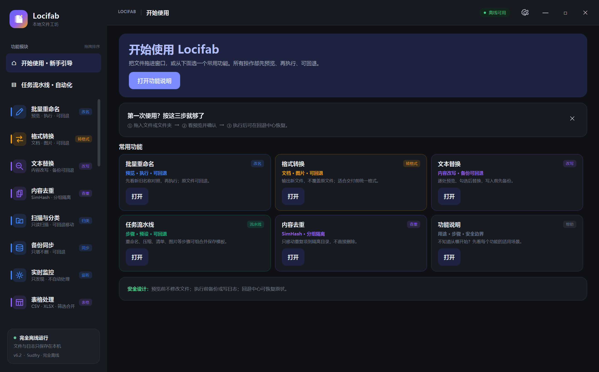
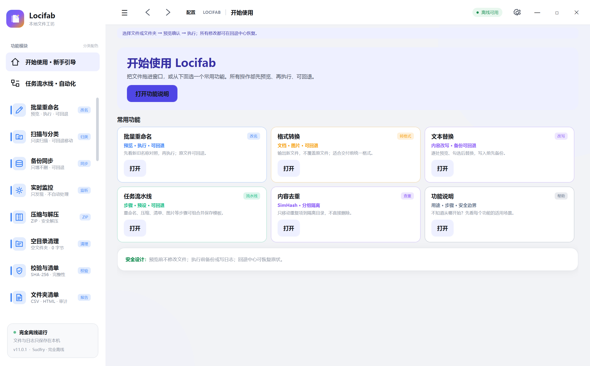
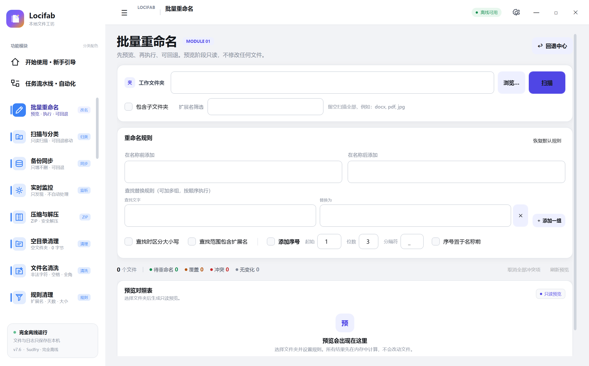
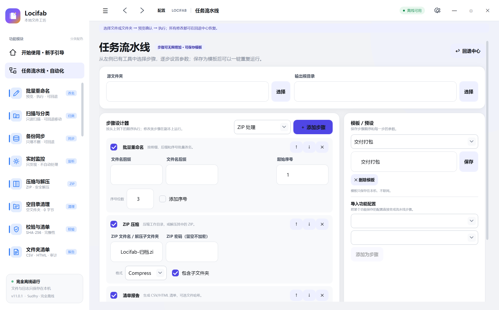
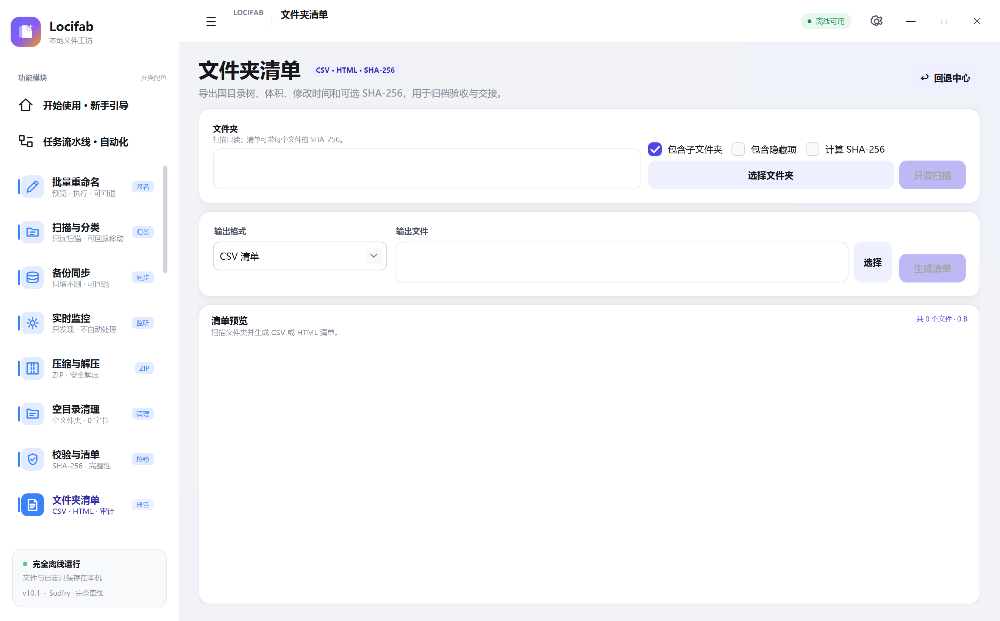
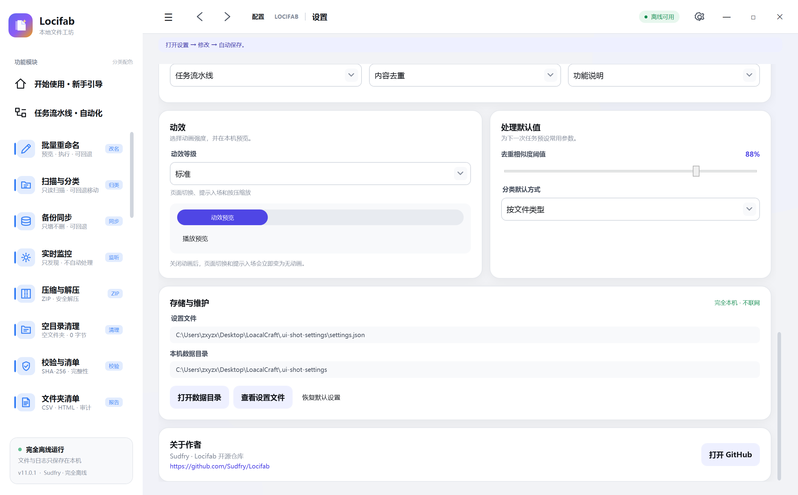
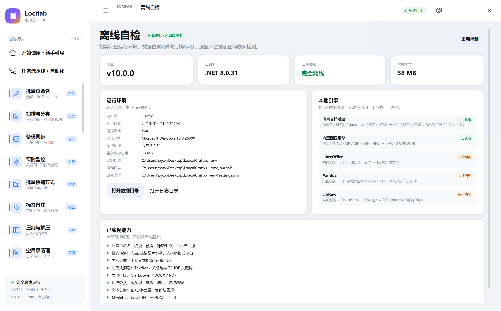
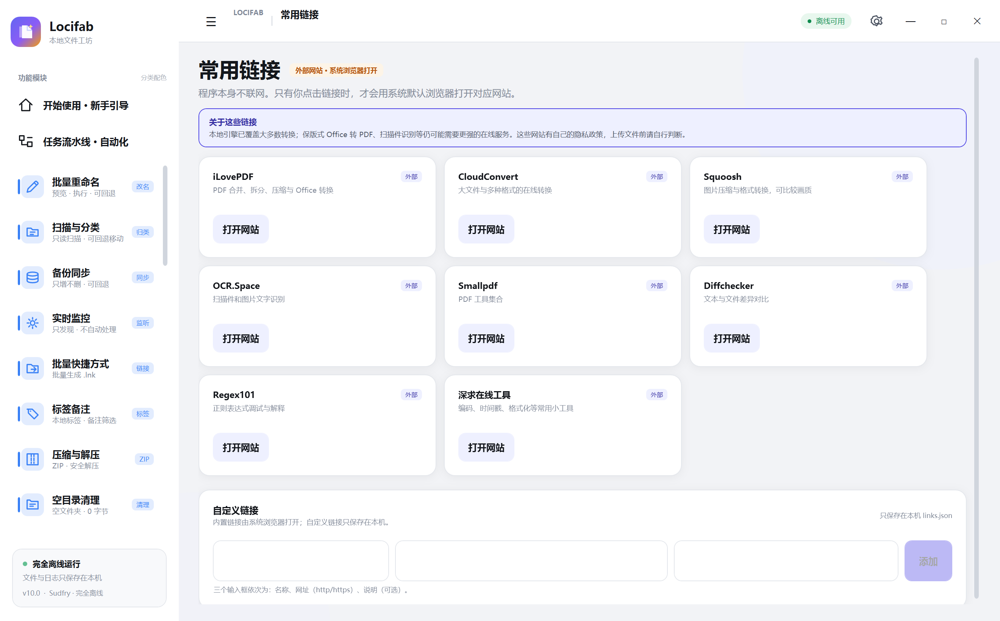

<p align="center">
  
</p>

<h1 align="center">Locifab · 本地文件工坊</h1>

<p align="center">
  完全离线 · 单文件运行 · 先预览再执行 · 可回退 · 可组合流水线
</p>

<p align="center">
  
  
  
  
  
</p>

<p align="center">
  <b>作者：Sudfry</b> ·
  <a href="https://github.com/Sudfry/Locifab">GitHub 仓库</a>
</p>

---

## 目录

- [项目简介](#项目简介)
- [界面预览](#界面预览)
- [功能](#功能)
- [安全与回退](#安全与回退)
- [流水线](#流水线)
- [技术架构](#技术架构)
- [快速开始](#快速开始)
- [构建与发布](#构建与发布)
- [测试](#测试)
- [项目结构](#项目结构)
- [已知限制](#已知限制)
- [许可证](#许可证)

---

## 项目简介

Locifab 是一个面向普通用户与小型团队的 **Windows 离线文件工作台**。

它把日常高频的文件操作集中到一个软件里：

- 批量重命名
- 格式转换
- 图片压缩、检查、批处理
- 内容去重、相似照片
- 压缩解压、备份同步、校验清单
- 分类、清理、时间属性、拆分合并
- 任务流水线、配置模块、回退中心

所有操作都在本机完成：

- 不联网
- 不上传文件
- 不调用 AI / 外部 API
- 不需要安装 .NET 运行时
- 单个 `Locifab.exe` 复制到 U 盘即可运行

---

## 界面预览

### 首页



### 批量重命名



### 任务流水线



### 文件夹清单 · 可折叠目录树



### 设置与作者入口



### 离线自检



### 常用链接



---

## 功能

### 文件整理

| 功能 | 能力 |
|---|---|
| 批量重命名 | 前缀、后缀、查找替换、序号、排序 |
| 扫描与分类 | 按类型/年份/月份/名称前缀规划移动 |
| 备份同步 | 只增不删、严格比对、SHA-256 |
| 实时监控 | 只记录变化，不自动处理 |
| 压缩与解压 | ZIP 压缩、解压密码、路径穿越防护 |
| 空目录清理 | 空文件夹、0 字节文件 |
| 时间与属性 | 修改时间、只读、隐藏、存档 |
| 校验与清单 | SHA-256 清单生成/校验 |
| 文件夹清单 | 目录树 + CSV/HTML 导出 |
| 拆分与合并 | 大文件分片、分片合并 |

### 文本与内容

| 功能 | 能力 |
|---|---|
| 文本替换 | 正则、扩展名范围、备份与回退 |
| 元数据清理 | DOCX/XLSX/PPTX 属性、图片 EXIF |
| 内容去重 | 中文二元组 + SimHash |
| 相似照片 | 感知哈希 + 阈值分组 |

### 图片与媒体

| 功能 | 能力 |
|---|---|
| 图片批处理 | 缩放、格式、质量、水印 |
| 图片压缩 | 目标 KB，自动质量与尺寸下降 |
| 图片检查 | 损坏/截断检测与隔离 |
| 内嵌图片 | Office 媒体提取、PDF 内嵌 JPEG |

### 自动化

| 功能 | 能力 |
|---|---|
| 任务流水线 | 步骤编排、预览、执行、日志、模板 |
| 功能配置 | 保存/应用/导出/导入当前工具设置 |
| 流水线导入 | 按“功能 → 模板”导入为步骤 |
| 回退中心 | 逐条记录、删除、逆向恢复 |

---

## 安全与回退

所有批量操作遵循统一流程：

```text
先选择 → 再预览 → 确认执行 → 可回退
```

### 为什么安全

1. **执行前写日志**
   - 旧路径、新路径、备份路径、状态。
2. **冲突先提示**
   - 重命名、分类、转换都会先生成预览。
3. **失败自动补偿**
   - 中途失败尽量回滚已处理项。
4. **统一回退中心**
   - 按批次恢复，不依赖系统撤销。
5. **数据目录回退**
   - `%LOCALAPPDATA%` 不可写时自动使用程序目录或临时目录。

日志位置：

```text
%LOCALAPPDATA%\Locifab\journals
```

便携模式回退位置：

```text
<程序目录>\LocifabData\journals
```

---

## 流水线

### 执行模型

```text
源目录
  ↓ 创建副本
工作副本
  ↓ 按步骤执行
输出目录
  ↓ 写入日志
回退中心
```

特点：

- 源目录不会被直接修改。
- 每一步独立记录日志。
- 支持步骤启用/禁用、上下移动、删除。
- 支持保存为流水线模板。

### 模板与配置模块

- **功能配置**：为单个工具保存多套命名配置。
- **配置快照**：保存配置时生成对应的流水线步骤快照。
- **导入流水线**：
  1. 选择功能；
  2. 选择该功能的模板；
  3. 添加为步骤。
- 导入的步骤只显示“模板：名称”，参数隐藏，执行时使用快照。

### 内置模板

- 全流程-输入整理交付
- 素材库清洗
- 文档交付与隐私
- 备份前审计
- 导入配置模块组合
- 交付打包
- 隐私交付
- 照片交付包
- 审计清单
- Office 素材提取
- 项目目录初始化
- 上架图片包
- 文档隐私交付
- 课程资料归档

---

## 技术架构

```text
src/
├─ LocalCraft.App/          WPF 界面、导航、页面、ViewModel
├─ LocalCraft.Core/         文件操作、日志、回退、备份、校验
└─ LocalCraft.Conversion/   图片/文档转换引擎
```

### 关键选择

| 技术 | 说明 |
|---|---|
| C# / .NET 8 | 单文件自包含发布 |
| WPF | 原生 Windows 桌面体验 |
| 手写 MVVM | 不引入第三方框架依赖 |
| WIC | Windows 原生图片编解码 |
| System.Text.Json | 日志、模板、配置持久化 |
| 自定义 ZIP 加密 | 标准 ZipCrypto 兼容 |
| SHA-256 / SimHash | 校验与相似内容分组 |

### 分层

- **App**：只负责界面与交互。
- **Core**：不依赖 WPF，便于测试与复用。
- **Conversion**：格式适配与编解码引擎。
- **Tests**：核心断言与流水线端到端测试。

---

## 快速开始

### 直接使用

1. 下载 `Locifab.exe`。
2. 双击运行。
3. 选择功能或拖入文件。
4. 先点预览，再执行。

不需要安装 .NET，不需要联网。

### 便携模式

把 `Locifab.exe` 放到 U 盘即可。

如果本机 `%LOCALAPPDATA%` 不可写，程序会自动使用同目录下的 `LocifabData`。

---

## 构建与发布

### 环境

- Windows 10 / 11 x64
- .NET 8 SDK（仅开发者需要）

### 构建

```powershell
dotnet build .\LocalCraft.sln -c Release
```

### 发布单文件

```powershell
powershell -NoProfile -ExecutionPolicy Bypass -File .\scripts\publish-win-x64.ps1
```

输出：

```text
publish\win-x64\Locifab.exe
```

### 发布参数

- `PublishSingleFile=true`
- `SelfContained=true`
- `PublishTrimmed=false`
- `EnableCompressionInSingleFile=true`

---

## 测试

### 一键测试

```powershell
powershell -NoProfile -ExecutionPolicy Bypass -File .\scripts\run-full-test.ps1
```

### 核心自测

```powershell
dotnet run --project .\tests\LocalCraft.SelfTest\LocalCraft.SelfTest.csproj -c Release --no-build --nologo
```

结果：

```text
断言：182，失败：0
全部通过
```

### 流水线端到端

```powershell
dotnet build .\tests\Harness\Harness.csproj -c Release
dotnet .\tests\Harness\bin\Release\net8.0-windows\Harness.dll
```

结果：

```text
14 套流水线模板
19 个功能配置
全部通过
```

详细报告：[docs/测试报告.md](docs/测试报告.md)

---

## 测试数据与模板

`tests/artifacts/测试数据与模板.zip` 包含：

- 434 个测试文件
- 19 个功能配置
- 14 套流水线模板

生成脚本：

```powershell
python tests/gen_testdata_10_1.py
python tests/gen_testtemplates_10_1.py
```

---

## 项目结构

```text
LocalCraft/
├─ src/
│  ├─ LocalCraft.App/
│  ├─ LocalCraft.Core/
│  └─ LocalCraft.Conversion/
├─ tests/
│  ├─ LocalCraft.SelfTest/
│  ├─ Harness/
│  └─ artifacts/
├─ docs/
│  ├─ 答辩文档.md
│  ├─ 测试报告.md
│  └─ screenshots/
├─ scripts/
│  ├─ publish-win-x64.ps1
│  └─ run-full-test.ps1
├─ README.md
├─ LICENSE
└─ LocalCraft.sln
```

---

## 已知限制

- 视频裁剪未实现：未内置视频编码器，避免生成损坏文件。
- PDF 内嵌图片只提取可识别 JPEG 图像流。
- HEIC/RAW 依赖 Windows 系统解码器。
- 内置 PDF 排版以视觉还原为主，复杂表格/公式有限。
- 单个工具 UI 未逐页自动化点击，核心服务由 182 项自测覆盖。

---

## 许可证

MIT License，见 [LICENSE](LICENSE)。

Copyright © 2026 Sudfry
