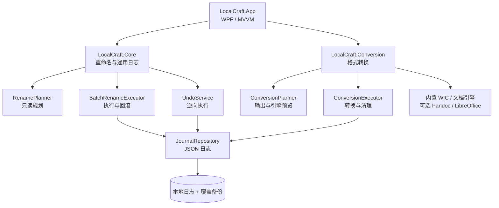

# LocalCraft 架构设计（v1.9）

## 1. 产品约束

- Windows 桌面、完全离线、自包含分发。
- 所有批量修改必须先预览、再执行、可回退。
- 核心功能不依赖网络、外部 API 或 AI 模型。
- 轻量：WPF + .NET 基础库，单文件自包含，避免浏览器内核。
- 模块 1–6 共用日志、预览和回退中心；分类移动复用重命名执行器，去重/摘要复用本地文本提取与文本指纹。

## 2. 分层



### LocalCraft.Core

没有 WPF 引用，可在控制台测试。负责：

- 重命名规划、冲突检测与文件名校验。
- 批量重命名 / 移动事务、覆盖备份与自动回滚。
- 统一 JSON 日志模型与持久化。
- `UndoService`：依据日志恢复重命名/移动/文本替换/备份同步，或删除转换/表格输出。
- 纯本地分析算法：中文 bigram 分词、64 位 SimHash、TextRank、TF-IDF。
- 只读分类规划：按类型、年份、年月、名称前缀生成移动计划。
- 文本替换：只读扫描、正则/字面量、二进制过滤、原文备份与回滚。
- 备份同步：差异分析、严格哈希比对、只增不删、目标旧版本备份。
- 表格：CSV/TSV 解析、OOXML xlsx 读取、筛选/排序/合并与 CSV 导出。
- 归档：ZIP 压缩/安全解压、同名避让与输出回退。
- 清理：空目录/零字节文件扫描、二次确认与回退重建。
- 校验：SHA-256 清单生成与缺失/变化校验。

### LocalCraft.Conversion

Windows 专用的转换内核：

- `ConversionPlanner`：只读计算输出路径、检测同名冲突、匹配引擎。
- `ConversionExecutor`：临时文件 → 成功改名；失败清理整批输出。
- 内置 WIC 图像引擎与纯 C# 文档引擎。
- PDF 输出：FlowDocument 中文排版 → 页面位图 → 本地 PDF 封装。
- PDF 输入：轻量文本层提取器（FlateDecode + ToUnicode），不处理扫描件 OCR。
- 可选的 Pandoc / LibreOffice 适配器，只在本地存在时启用。
- 所有结果写入与模块 1 相同的 `OperationJournal`，`Kind = convert`。

### LocalCraft.App

- WPF + 手写 MVVM，无第三方包。
- `MainViewModel` 负责导航；原有 6 个模块 ViewModel 之外，新增 `TextReplaceViewModel`、`BackupViewModel`、`WatchViewModel`、`TableViewModel`、`EnvironmentViewModel`、`LinksViewModel`、`OnlineViewModel`。
- 左侧导航使用 Path 矢量线性图标；顶部齿轮打开常用设置 Popup。
- `ThemeService` 将浅/深/主题色/密度写入应用资源，XAML 使用 `DynamicResource` 实时响应。
- 页切换动画、按钮悬停缩放和提示入场动画由 WPF Storyboard 驱动，可被设置关闭。
- 视图与核心通过普通 C# 对象交互，文件系统逻辑不写进 code-behind。
- 自定义窗口外壳 + Per-Monitor V2 + `Viewbox` 等比适配，在 100%–200% 缩放下不横向裁切。

## 3. 模块划分

| 模块 | 核心输入 | 处理 | 状态 |
|---|---|---|---|
| 1 批量重命名 | 文件列表 + 命名规则 | 只读规划 → 执行 → 回退 | ✅ 已完成 |
| 2 格式转换 | 文件队列 + 目标格式 | 内置文档 / WIC 图像 / PDF 输出，可选外部引擎 | ✅ 已完成（外部格式按检测） |
| 3 内容去重 | 文档文本 | 文本提取 + SimHash + 隔离移动 | ✅ 已完成 |
| 4 抽取式摘要 | 单文档文本 | TextRank / TF-IDF + 原文定位 | ✅ 已完成 |
| 5 导出与排版 | 文档队列 | Markdown / DOCX / PDF | ✅ 已完成 |
| 6 扫描分类 | 文件夹 + 规则 | 只读索引 → 移动预览 → 回退 | ✅ 已完成 |

## 4. 模块 1：可回退重命名

### 4.1 只读规划

`RenamePlanner.CreatePlan()` 只计算，不写盘。输入文件先规范化、去重、自然排序，然后逐项：

1. 应用前缀、后缀、查找替换和序号。
2. 校验文件名：空主体、非法字符、结尾空格/句点、Windows 保留名、组件长度、完整路径长度。
3. 检测目标文件夹、目标同名文件、批次内目标重复、批次内源文件占用。
4. 仅大小写改变时标为可执行，由执行器用临时文件中转。
5. 未改变名称的项标为「无变化」，界面默认不勾选。

状态：`Ready / Overwrite / Conflict / Unchanged / Invalid`。`Conflict` 与 `Invalid` 都会阻断提交，直到用户取消勾选或调整规则。

### 4.2 执行事务

1. 再次预检，防止预览后文件系统变化。
2. 生成 `OperationJournal(Status=Prepared)`，先写日志。
3. 若目标已存在且允许覆盖：目标先移入 `backups/<journalId>/` 并记录备份路径。
4. 源文件重命名到目标；更新日志状态并周期性落盘。
5. 全部成功后日志变为 `Completed`。
6. 任一步失败：逆序恢复已完成的改名，并还原备份；状态为 `RolledBack` 或 `Failed`。

设计取舍：

- 采用「备份后移动」，保证被覆盖文件也能恢复。
- 批次内目标与源文件互占时报冲突，不隐式解决链式改名。
- 日志原子写入，避免半截 JSON。
- 使用 25 个操作一个 checkpoint，兼顾写入放大与可追踪性。

### 4.3 回退

1. 重新加载最新日志，校验 `Completed` 且操作状态完整。
2. 预检目标文件、原路径占用、备份是否存在。
3. 日志标为 `Undoing`。
4. 逆序执行：新文件 → 原路径；若覆盖过，再从备份恢复原目标。
5. 标记 `Undone` 并清理该批次备份。
6. 中途失败时尝试补偿，把文件恢复到回退前状态。

## 5. 模块 2：格式转换

### 5.1 转换计划

`ConversionPlanner.CreatePlan()`：

1. 规范化源路径、去重并按自然顺序排序。
2. 校验输出目录和源文件是否存在。
3. 按「输入类别 × 目标格式」匹配引擎；不匹配的任务标记 `Unsupported`，需要外部引擎的标记 `MissingEngine`。
4. 计算输出文件名。若同名文件已存在，自动追加 `_1`、`_2`，不会覆盖。
5. 预览阶段绝不创建输出目录或文件。

输出路径在计划生成时确定，执行前再次确认目标未被外部创建，否则整批回滚。

### 5.2 内置文档引擎

路径：`LocalCraft.Conversion/Engines/BuiltInDocumentEngine.cs`

- 输入：DOCX、PPTX、Markdown、TXT、HTML。
- 输出：Markdown、TXT、HTML、DOCX、PDF。
- DOCX 解析：`System.IO.Compression` + `XDocument` 读取 `word/document.xml`，提取段落、标题样式、列表与表格文本。
- PPTX 解析：读取 `ppt/slides/slideN.xml`，按页提取文本。
- Markdown / HTML / TXT：本地解析为统一 `SimpleDocument`。
- DOCX 输出：生成最小 Open XML 包（`[Content_Types].xml`、`_rels/.rels`、`document.xml`、`styles.xml`），包含：
  - 中文默认字体 Microsoft YaHei
  - Normal / Heading1–3 样式
  - 段落间距、A4 页面尺寸和基础列表缩进
- 不依赖 Office、Pandoc 或 LibreOffice。

### 5.3 内置图像引擎

路径：`BuiltInImageEngine.cs`

- 基于 WPF / Windows Imaging Component 解码与编码。
- 支持输入：JPG/JPEG、PNG、BMP、GIF、TIF/TIFF；HEIC/RAW 取决于系统 WIC 解码器。
- 支持输出：JPG、PNG、BMP、GIF、TIFF。
- JPEG / GIF 需要压平透明通道，使用白底合成。
- 转换结果为第一帧（GIF/TIFF 多帧会取首帧）。
- 所有图像在内存中处理后顺序写盘，批次不在内存中累积全部图片。

### 5.4 外部引擎适配

`ConversionEngineCatalog` 启动时探测：

- LibreOffice：`engines/libreoffice/program/soffice.exe`、标准安装目录、PATH。
- Pandoc：`engines/pandoc/pandoc.exe`、PATH。
- LibRaw：v0.4 尚未打包，RAW 只尝试系统 WIC；检测不到时任务会明确失败。

适配器通过 `ProcessStartInfo.ArgumentList` 启动本地进程，不使用 shell 拼接；设置超时，取消时结束进程树。没有检测到引擎时，对应任务永远不会进入执行队列。

### 5.5 转换执行与回退

1. 写入 `Kind=convert` 的日志，先于输出创建。
2. 每个任务在目标目录生成唯一临时文件。
3. 引擎写入临时文件。
4. 成功后改名到最终输出，操作标记 `Completed`。
5. 失败或取消：删除本次已创建的输出，日志标记 `RolledBack`。
6. 全部成功后日志标记 `Completed`。

转换回退与重命名不同：原始文件从未被修改，回退只需删除该批次生成的输出文件。`UndoService` 按日志 `Kind` 分流，`UndoConversion()` 会拒绝删除输出与源相同的路径。

### 5.6 日志扩展

现有字段保持不变：

```json
{
  "formatVersion": 1,
  "kind": "convert",
  "displayName": "批量格式转换",
  "status": "completed",
  "operations": [
    {
      "sourcePath": "C:\\资料\\会议纪要.md",
      "targetPath": "C:\\资料\\LocalCraft_转换\\会议纪要.docx",
      "state": "completed",
      "note": "已转换为 Word 文档 DOCX · LocalCraft 内置文档引擎"
    }
  ]
}
```

回退中心根据 `kind` 显示不同按钮文案：「一键回退此批次」或「删除本次输出」。

## 6. 高 DPI 与窗口适配

- 进程通过清单和 `SetProcessDpiAwarenessContext` 请求 Per-Monitor V2。
- 窗口尺寸按 `SystemParameters.WorkArea` 收口，不超出小屏工作区。
- 内部 UI 使用固定 1320×820 设计画布，`Viewbox` 仅向下等比缩放；在 200% 缩放下文本仍有可读的物理尺寸。
- 表格启用行/列虚拟化，处理上千文件时仍只渲染可见行。

## 7. 安全与隐私

- 不引用 `HttpClient`、WebView、遥测 SDK。
- 文件操作只使用 `System.IO` 本地路径。
- 预览阶段零写入。
- 覆盖动作先备份；转换不覆盖已有输出。
- 日志目录、备份目录由同一数据根派生，拒绝越界删除。
- 外部引擎参数通过参数列表传递，不拼接 shell 命令。

## 8. 当前边界

- PDF 输入、旧版 DOC/PPT、PPTX 输出依赖 LibreOffice；v0.4 未打包该引擎。PDF 输出已由内置排版引擎完成。
- LibRaw 尚未打包；HEIC/RAW 只走 Windows 系统解码器。
- PDF 输出为页面图像，中文版式稳定但文字不可选中；扫描版 PDF 不做 OCR。
- 文档转换以文本级内容为主，不保留复杂 Word 页面布局、图片、公式或分栏。
- 转换不删除原始文件，也不支持覆盖已有输出。
- 去重基准文件固定为组内文本最长者，移出其余文件，不做自动删除。
- 分类移动会创建子文件夹；回退后空目录可能保留。
- 中断的未完成批次不会自动恢复，日志保留供人工核对。

## 9. 模块 3–6 设计

### 9.1 内容去重

1. `DocumentTextService.ExtractText()` 从 TXT/Markdown/HTML/DOCX/PPTX/PDF 文本层提取纯文本。
2. `TextTokenizer` 把中文切成字符 bigram、英文切成词元。
3. `SimHash.Compute()` 生成 64 位指纹；`DedupEngine` 按汉明距离阈值做连通分组。
4. UI 展示相似组、基准文件、相似度与隔离目标位置。
5. 移出重复项复用 `BatchRenameExecutor(kind=move, createTargetDirectories=true)`；日志可在回退中心恢复。

### 9.2 抽取式摘要

1. 按中文句号/问号/感叹号/分号与换行切句，保留字符偏移和行号。
2. 句间相似度构成 TextRank 图，迭代得到关键句权重。
3. TF-IDF 在句级文档频率上提取关键词。
4. 仅返回原文句子，不生成新内容。

### 9.3 导出与 PDF

- Markdown / DOCX 由 `BuiltInDocumentEngine` 生成；PDF 使用 `PdfRenderer`。
- `PdfRenderer`：
  1. 构造 A4 FlowDocument（Microsoft YaHei、标题 1–3、段距、列表、粗体、上下标）。
  2. 通过 `DocumentPaginator` 分页。
  3. 以 144 DPI 把每页渲染成 RGB 位图，Flate 压缩。
  4. 写一个最小 PDF，每页使用图像 XObject。
- 优点：完全离线、中文渲染不依赖外部字体解析；缺点：文字不可选中。
- 多格式导出允许同一源文件生成多个输出；`ConversionExecutor` 只要求输出路径唯一，不要求源路径唯一。

### 9.4 扫描分类

1. `ClassifyPlanner` 只读扫描并计算目标子文件夹：
   - 文件类型：图片 / 文档 / 视频 / 音频 / 压缩包 / 安装包 / 其他。
   - 修改年份、修改年月。
   - 名称前缀（1–4 字符）。
2. 规划阶段不创建目录；目标冲突会阻断。
3. 执行由 `BatchRenameExecutor` 的 `kind=move` 模式完成，并创建目标目录。
4. 回退走统一 `UndoService` 的移动恢复路径。

## 10. 设置与动效

### 10.1 设置持久化

- `AppSettingsService` 位于 `LocalCraft.Core/Settings`，将设置写入 `settings.json`。
- 使用原子写入（临时文件后替换），读取失败时回退默认值。
- 设置的字段：
  - `AnimationsEnabled`、`MotionLevel`
  - `RememberLastPage`、`LastPageKey`
  - `DefaultIncludeSubfolders`
  - `DedupThreshold`、`SummarySentenceCount`、`DefaultClassificationMode`
  - `Theme`、`Accent`、`Density`、`SidebarWidth`
- 设置页和顶部「常用设置」共享同一个 `SettingsViewModel`，修改即保存。
- 新任务的 ViewModel 构造时读取默认值；导航栏记录最后页面。

### 10.2 动画

- `MotionPreferences` 保存运行时动画快照（开关和等级）。
- `MainWindow` 监听 `CurrentPage`，对 `PageHost` 执行淡入 + 上移动画。
- `BaseButton` 模板在悬停时对内部 `ScaleTransform` 做轻量缩放。
- `PopupAnimation="Slide"` 用于常用设置面板。
- `FadeSlide` 附加行为可为动态出现的提示元素提供淡入 + 上移。
- 设置页提供本地动画预览；关闭动画后页面与提示入场立即停止。

### 10.3 主题与布局

- `ThemeService` 在启动时和设置保存时应用调色板。
- 浅色/深色由 `ThemeMode` 决定；`Auto` 读取 Windows `AppsUseLightTheme` 注册表项。
- 7 种主题色只替换品牌色与派生色，状态色（成功/警告/危险）保持语义稳定。
- 密度联动卡片留白、DataGrid 行高、表头高度、输入框高度和导航行高。
- 侧栏宽度通过 `MainViewModel.SidebarWidthGrid` 绑定，实时刷新且限制在 200–300 px。

## 11. 新增工具

- 文本替换使用 `replace` 日志；执行前备份全部原文件，取消/失败时自动恢复。
- 备份同步使用 `backup` 日志；新增目标回退时删除，更新目标回退时恢复旧版本。
- 表格导出使用 `table` 日志；回退复用“删除本批输出”的转换语义。
- 实时监控只持有 `FileSystemWatcher` 与内存队列，不写文件操作日志，因为不修改文件。
- 离线自检只读取进程信息和本机外部引擎路径，不发起网络请求。
- 常用链接保存到 `links.json`；由系统浏览器打开，程序自身不使用 HTTP 客户端。

## 12. 后续增强

- 打包 LibRaw / LibreOffice 可选引擎，完成 RAW 与旧版 Office、PDF 输入的完全离线覆盖。
- 增加 PDF 文本层（当前中文 PDF 为页面图像）。
- 为去重组提供任意基准文件选择与删除到回收站选项。
- 为分类增加规则组合（例如“类型 + 年份”）和空目录清理。
